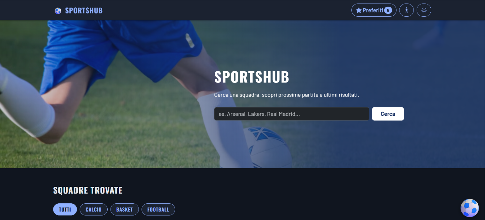
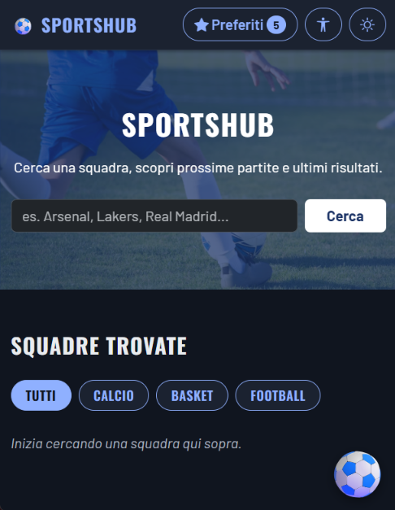
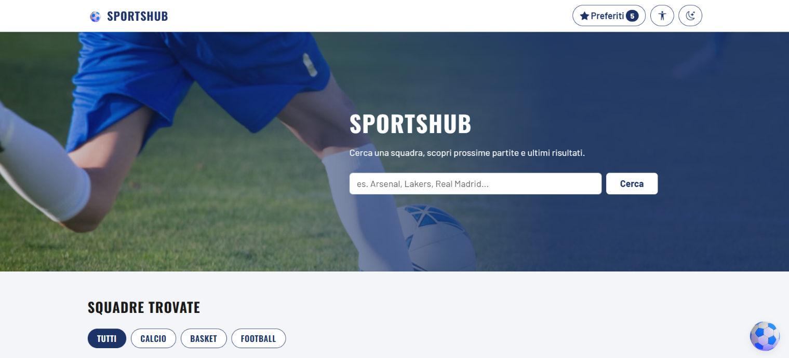
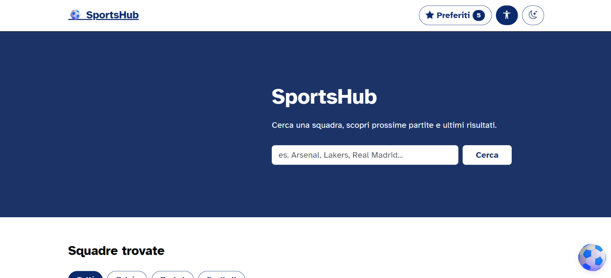

# ⚽ SPORTSHUB - Web app di ricerca squadre

       

Questa repository contiene il codice sorgente di **SportsHub**, una web app che permette di cercare una squadra sportiva, consultarne i prossimi eventi e gli ultimi risultati, salvare le proprie squadre preferite e seguirne gli appuntamenti. I dati arrivano in tempo reale dall'API pubblica di **TheSportsDB**. Il progetto è stato sviluppato come progetto d'esame del corso di Web Development.

## 🖼️ Anteprima


*Desktop con il tema scuro (predefinito)*

| Mobile | Tema chiaro | Modalità semplificata |
| :---: | :---: | :---: |
|  |  |  |

---

> ✅ **Stato del progetto:** completato: versione 3.0. Questo file viene aggiornato a mano a mano che il progetto viene realizzato.

## 📑 Indice

- [Anteprima](#-anteprima)
- [Funzionalità](#-funzionalità)
- [Tecnologie Utilizzate](#-tecnologie-utilizzate)
- [Come Eseguire il Progetto Locale](#-come-eseguire-il-progetto-locale)
- [Struttura del progetto](#-struttura-del-progetto)
- [Architettura, Responsive Design e Media Query](#-architettura-responsive-design-e-media-query)
- [Albero del DOM](#-albero-del-dom)
- [Validazione del campo di ricerca](#-validazione-del-campo-di-ricerca)
- [Come funziona](#-come-funziona)
- [Aspetto grafico](#-aspetto-grafico)
- [Extra e dettagli](#-extra-e-dettagli)
- [Accessibilità](#-accessibilità)
- [Convenzioni di codice](#-convenzioni-di-codice)
- [Aggiornamenti](#-aggiornamenti)
- [Crediti](#-crediti)
- [Realizzato da](#-realizzato-da)

### ✨ Funzionalità

L'applicazione è strutturata con Bootstrap 5 e resa dinamica con JavaScript nativo diviso in moduli ES:

- **Ricerca squadre**: richiesta GET a `searchteams.php` con URL costruito da `new URL()` e `searchParams`; parte da sola dopo 400ms di pausa nella digitazione (debounce) e annulla la ricerca precedente con `AbortController`.
- **Caricamento ed errori**: spinner durante le richieste, alert rosso in caso di errore, messaggio "Nessuna squadra trovata" se `teams` è `null`.
- **Filtro per sport**: bottoni Tutti / Calcio / Basket / Football sul campo `strSport`.
- **Dettagli squadra**: al click su una card si apre una modal con le informazioni della squadra; sotto, prossimi eventi e ultimi risultati caricati in parallelo con `Promise.all`.
- **Modal evento**: il click su una partita apre i suoi dettagli (tabellone, competizione, data e ora, stadio, stato).
- **Squadre preferite**: salvate in `localStorage`, con notifica a ogni aggiunta o rimozione; lista nascosta all'avvio e apribile con Mostra/Nascondi o dalla barra.
- **I tuoi prossimi appuntamenti**: prossime partite di tutte le preferite con `Promise.allSettled`, ordinate per data, con ora e luogo.
- **Ultimi risultati**: della Premier League e delle squadre preferite, in una striscia scorrevole di 9 partite con frecce, completata da partite di esempio segnate dal badge "Esempio".
- **Barra di navigazione**: bottone Preferiti con contatore, modalità semplificata e tema scuro / chiaro (predefinito: scuro), con le scelte salvate.
- **Footer**: pannelli "About us" e "Accessibilità" e copyright con l'anno automatico.
- **Pallone dell'app**: entra rotolando, mostra "Scarica la nostra app!" e apre la modal di invito all'app.

## 🛠️ Tecnologie Utilizzate

- **HTML5**: struttura semantica (`header`, `nav`, `main`, `section`, `article`, `footer`) con attributi di accessibilità.
- **CSS3**: variabili CSS per i temi, Flexbox, `clamp()`, `linear-gradient`, `scroll-snap`, transizioni, `@keyframes` e media query.
- **Bootstrap 5.3.8** (CDN): griglia, utility, form, navbar, spinner, alert, badge, modal, toast, collapse e tema con `data-bs-theme`. Si usa la 5.3.8 perché è l'ultima versione stabile riportata nella documentazione ufficiale (la 5.3.9 non lo è).
- **Bootstrap Icons 1.13.2** (CDN) e **Google Fonts** (Oswald, Barlow, Atkinson Hyperlegible).
- **JavaScript (ES6+)**: moduli ES, classi con campi `static`, `fetch` con `async/await`, `Promise.all` / `allSettled`, `AbortController`, debounce, `localStorage`, `Intl.DateTimeFormat`, API JavaScript di Bootstrap e DOM senza `innerHTML`.
- **TheSportsDB API v1** con la chiave gratuita `123` e foto da **Pexels** (vedi [Crediti](#-crediti)).
- **Shields.io**: i badge delle tecnologie in cima a questo README, con i loghi della raccolta Simple Icons.

> ⚠️ **Limiti della chiave gratuita:** la ricerca è limitata, gli endpoint degli eventi restituiscono una sola partita e il limite è di 30 richieste al minuto (oltre, status 429). Fonte: [documentazione ufficiale di TheSportsDB](https://www.thesportsdb.com/documentation).

## 🚀 Come Eseguire il Progetto Locale

1. **Clona il repository**:
   ```bash
   git clone https://github.com/lisasciacca/progetto-settimana-7
   ```

2. **Apri l'applicazione con Live Server**:
   Il progetto usa i **moduli ES** (`<script type="module">`), quindi **non** può essere aperto con un doppio clic su `index.html`, perché il browser bloccherebbe i moduli con un errore CORS. Usa un server locale, per esempio l'estensione **Live Server** di VS Code: tasto destro su `index.html` → *Open with Live Server*.

---

## 📁 Struttura del progetto

```text
.
├── assets/
│   ├── css/
│   │   └── style.css      stile personalizzato
│   ├── img/               screenshot di anteprima per il README
│   └── js/
│       ├── main.js        punto di ingresso: eventi e coordinamento
│       ├── api.js         chiamate fetch verso TheSportsDB
│       ├── ui.js          creazione degli elementi nel DOM
│       ├── storage.js     salvataggio dei preferiti in localStorage
│       ├── tema.js        gestione del tema chiaro / scuro
│       ├── semplificata.js  modalità semplificata (accessibilità)
│       ├── segnaposto.js  partite di esempio per completare i risultati
│       ├── Squadra.js     class Squadra
│       └── Evento.js      class Evento
├── .gitignore
├── index.html             struttura principale della web app
└── README.md              documentazione del progetto
```

---

## 📱 Architettura, Responsive Design e Media Query

Approccio **One-page** e **Mobile-First**, con il contenuto centrato in un contenitore largo al massimo `1100px` e una barra di navigazione fissa in alto (`sticky-top`).

- **Mobile (<768px)**: hero con testo centrato, una card squadra per riga, una partita visibile nella striscia, dettagli su una colonna, footer su due righe.
- **Tablet (768px - 991px)**: hero con testo a destra della foto, due card per riga, due partite visibili, dettagli su due colonne.
- **PC (≥992px)**: tre card per riga e tre partite visibili.

Le card squadra usano `flex: 1 1 280px`, quindi si adattano da sole; le strisce di partite usano le media query `min-width: 768px` e `992px`. `prefers-reduced-motion` disattiva le animazioni.

---

## 🌳 Albero del DOM

* **`<header class="barra">`**: navbar con marchio `#link-marchio` e bottoni `#btn-vai-preferiti`, `#btn-semplificata`, `#btn-tema`.
* **`<main>`**:
  * **Hero**: titolo `#titolo-hero` e form `#form-ricerca`.
  * **Squadre trovate**: filtri `#filtri-sport`, `#errore`, `#spinner`, `#lista-squadre` e `#dettagli`.
  * **Ultimi risultati – Premier League**: `#risultati-lega`.
  * **Squadre preferite**: collapse `#contenitore-preferiti` con `#lista-preferiti`.
  * **Prossimi appuntamenti**: `#lista-appuntamenti`.
  * **Ultimi risultati delle tue squadre**: `#risultati-preferite`.
* **`<footer>`**: bottoni About us / Accessibilità, pannelli `#footer-pannelli`, anno `#anno-corrente`.
* **Pallone dell'app** `#palla-app`, **notifica** `#notifica` e **modal** `#modale-squadra`, `#modale-evento`, `#modale-app`.

---

## ✅ Validazione del campo di ricerca

| Campo | Regola | Cosa controlla il browser |
| ----- | ----- | ----- |
| **Nome della squadra** | `type="search"` + `required` | Che non sia vuoto prima di inviare il form |

Il valore viene ripulito con `trim()`: se resta vuoto la ricerca non parte e torna il messaggio iniziale.

**Sequenza di ricerca:**
> Digitazione → 400ms di pausa (o subito con Cerca: campo svuotato e pagina che scende ai risultati) → `trim()` → ricerca precedente annullata con `abort()` → spinner → `cercaSquadre()` → card filtrate per sport, "Nessuna squadra trovata" o alert rosso → il `finally` nasconde lo spinner.

---

## ⚙️ Come funziona

1. **`Squadra.js` ed `Evento.js`**: classi che traducono i dati grezzi dell'API in proprietà chiare. `Evento` formatta data e ora in italiano con `Intl.DateTimeFormat`, traduce gli stati con `static STATI` e genera il punteggio.
2. **`api.js`**: `getJSON()` esegue la `fetch` e controlla `response.ok`; `cercaSquadre()`, `caricaEventi()` (con `Promise.all`), `caricaProssimiEventi()`, `caricaUltimiEventi()` e `caricaUltimiEventiLega()` restituiscono oggetti `Squadra` / `Evento`.
3. **`storage.js`, `tema.js`, `semplificata.js`**: leggono e salvano in `localStorage` preferiti, tema (predefinito: scuro) e modalità semplificata, con `try/catch`; tema e modalità sono attributi su `<html>` (`data-bs-theme`, `data-semplificata`).
4. **`segnaposto.js`**: `completaConEsempi()` porta le sezioni dei risultati a 9 partite con partite di esempio (`esempio = true`).
5. **`ui.js`**: crea tutti gli elementi con `createElement` e `textContent` (card, liste, strisce con frecce e `scrollBy()`, modal, notifiche).
6. **`main.js`**: collega gli eventi e tiene lo stato. Usa l'**event delegation** sulle liste, il **debounce** con `AbortController` per la ricerca, `Promise.allSettled` per appuntamenti e risultati delle preferite (con un contatore di versione contro i caricamenti superati) e l'API JavaScript di Bootstrap per modal, toast e collapse. Gestisce anche lo scorrimento (`portaA()`, `comportamentoScorrimento()`) e il pallone che si alza sopra le notifiche.

---

## 🎨 Aspetto grafico

**Tema scuro (predefinito)**: sfondo blu notte (`#10151f`), card grigio-blu scuro (`#1b2230`) e accenti in azzurro `#8fb0ff`, molto leggibile sullo scuro. **Tema chiaro**: sfondo grigio chiarissimo (`#f4f5f8`), card bianche e accenti nel blu `#1b3366`. Tutti i colori sono variabili CSS, quindi il cambio di tema avviene in un punto solo.

**Tipografia e icone**: titoli in **Oswald**, maiuscolo e spaziato come sui tabelloni degli stadi; testo in **Barlow**. Icone a linea di **Bootstrap Icons**; l'unica emoji è il pallone ⚽ del marchio e del bottone dell'app.

**Dettagli**: hero a tutta larghezza con una foto specchiata e un velo blu; card partita come piccoli tabelloni con i loghi; badge verdi per i punteggi; filtri a pillola. L'azzurro `#8fb0ff` torna nell'alone delle card, nel bordo delle modal e nei link del footer.

**Animazioni**: card ed eventi si sollevano all'hover, la foto della hero entra da sinistra, il pallone dell'app rotola dentro, i link del footer hanno una sottolineatura che cresce e nella modal dell'app la foto sfuma nel contenuto.

---

## 💡 Extra e dettagli

- **Pulizia dell'input** con `trim()` e **messaggi di stato vuoto** ("Nessun risultato disponibile", "Nessuna squadra trovata per questo sport"). Gestito da JS.
- **Logo opzionale** e **iniziali** al posto del logo mancante. Gestito da JS.
- **Bottone "Già nei preferiti" disabilitato**. Gestito da JS e CSS.
- **Appuntamenti**: sempre aggiornati, senza doppioni, con ora e luogo e avviso per le squadre non caricate. Gestito da JS e CSS.
- **Modal info squadra** e **scorrimenti automatici** (ai risultati dopo la ricerca, alle liste dopo la modal). Gestito da HTML e JS.
- **Notifiche sui preferiti** con toast Bootstrap. Gestito da HTML, CSS e JS.
- **Barra di navigazione** con tema, modalità semplificata e contatore preferiti, e **mostra/nascondi dei preferiti**. Gestito da HTML, CSS e JS.
- **Ultimi risultati** della Premier League e delle preferite, con **partite di esempio** e **striscia scorrevole**. Gestito da HTML, CSS e JS.
- **Footer** con pannelli e anno automatico. Gestito da HTML e JS.
- **Pallone e modal dell'app**. Gestito da HTML, CSS e JS.
- **Stati e orari in italiano** nella modal dell'evento. Gestito da JS.

---

## ♿ Accessibilità

- **Tastiera**: card raggiungibili con Tab e apribili con Invio o Spazio, contorni di focus visibili, finestrella del pallone raggiungibile (`:focus-within`) e chiudibile con Esc.
- **Screen reader**: label nascosta sull'input, `aria-labelledby` sulle sezioni, `role="alert"` sull'errore, `role="status"` e `aria-live` sulle notifiche, `aria-pressed` su filtri e modalità semplificata, `aria-expanded` sui collapse, `aria-label` sui bottoni con sole icone; immagini e icone decorative nascoste (`alt=""`, `aria-hidden`).
- **Focus guidato**: dopo la ricerca e alla chiusura della modal il focus passa al titolo dei risultati o dei dettagli.
- **Modalità semplificata**: testo più grande, contrasto alto, font Atkinson Hyperlegible, niente animazioni, link sottolineati e focus più spesso, in entrambi i temi.
- **Riduci animazioni**: con `prefers-reduced-motion` tutte le animazioni e gli scorrimenti fluidi vengono disattivati.

---

## 📝 Convenzioni di codice

- **camelCase** per variabili, funzioni e riferimenti agli elementi DOM.
- **PascalCase** per le classi e per i file che le contengono (`Squadra.js`, `Evento.js`).
- **UPPER_CASE** per le costanti di configurazione (`BASE_URL`).
- **Un modulo, un compito**: `api.js` non tocca il DOM, `ui.js` non esegue fetch, `storage.js` gestisce solo i preferiti in `localStorage`, `tema.js` solo il tema, `semplificata.js` solo la modalità semplificata e `segnaposto.js` solo le partite di esempio.
- **Variabili CSS** con prefisso `--sh-` (SportsHub), per non confonderle con quelle di Bootstrap (`--bs-`).
- **CSS con indice**: in cima a `style.css` c'è un indice delle 21 sezioni, numerate anche nelle intestazioni (per saltare a una sezione si cerca, per esempio, `===== 11.`).
- **Intestazione nei moduli JS**: ogni file inizia con un commento che spiega a cosa serve.
- **Commenti esplicativi** presenti in HTML, CSS e JS per agevolare la lettura del codice.

---

## 🔄 Aggiornamenti

| Versione | Descrizione |
| :--- | :--- |
| **ver. 1.0** | Struttura HTML semantica e stile CSS con Bootstrap 5 |
| **ver. 2.0** | Versione base: ricerca squadre e dettagli eventi |
| **└─ ver. 2.1** | Versione avanzata: preferiti, appuntamenti, filtri e modal |
| **ver. 3.0** | Versione completa: nuova grafica, accessibilità e ultimi risultati |
| **└─ ver. 3.1** | Readme aggiornato |

---

## 🙏 Crediti

- **Dati**: [TheSportsDB](https://www.thesportsdb.com).
- **Foto della hero**: Kampus Production su [Pexels](https://www.pexels.com/it-it/foto/campo-erba-sport-palla-8941651/).
- **Foto della modal dell'app**: Ferid Faiqoglu su [Pexels](https://www.pexels.com/it-it/foto/intensa-partita-di-calcio-con-contrasti-nello-stadio-di-baku-40189105/).
- **Icone**: [Bootstrap Icons](https://icons.getbootstrap.com).
- **Font**: Oswald, Barlow e Atkinson Hyperlegible da [Google Fonts](https://fonts.google.com).
- **Badge**: [Shields.io](https://shields.io), con i loghi di [Simple Icons](https://simpleicons.org).

---

## 👩‍💻 Realizzato da

| Persona | Ruolo |
| :--- | :--- |
| Lisa Irene Sciacca | README, HTML, CSS, JavaScript |